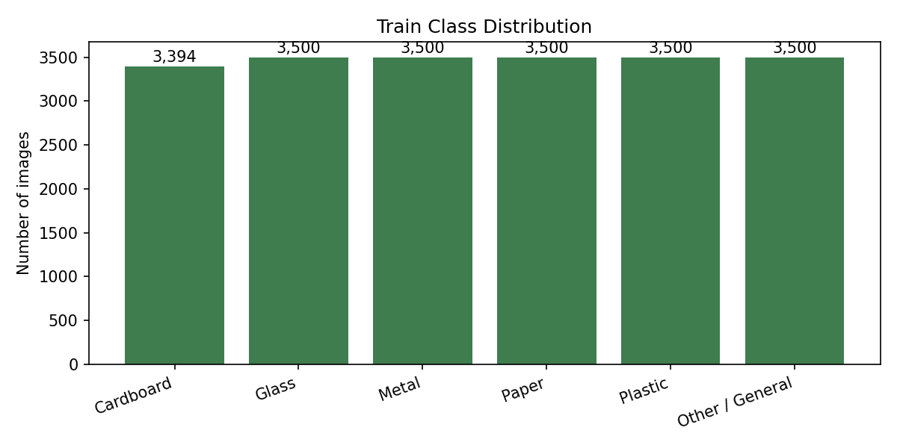
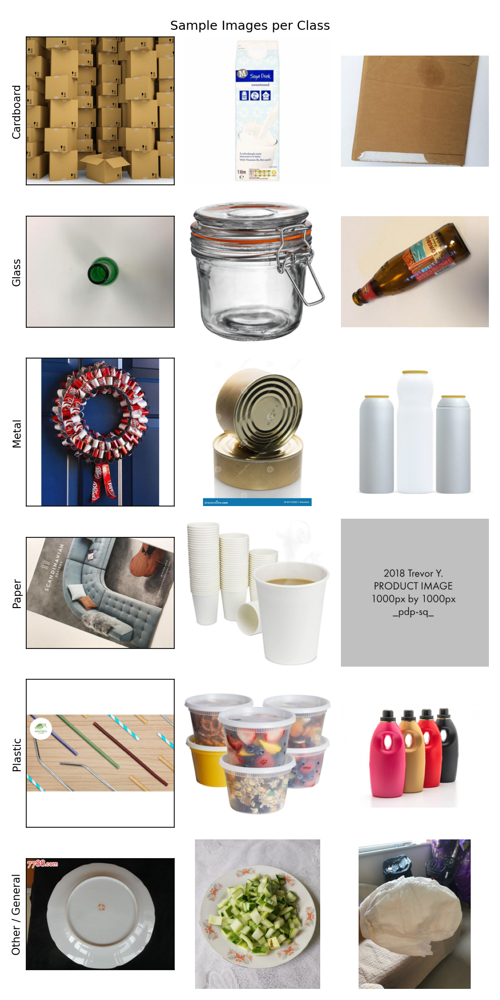
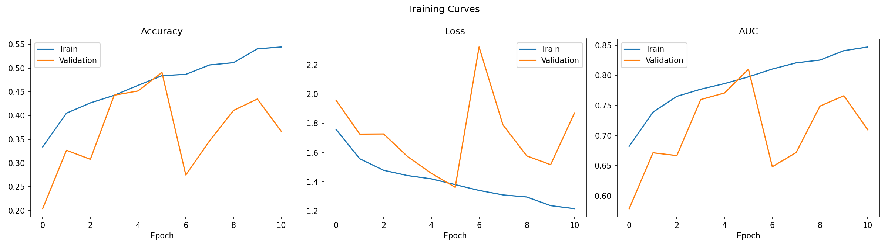
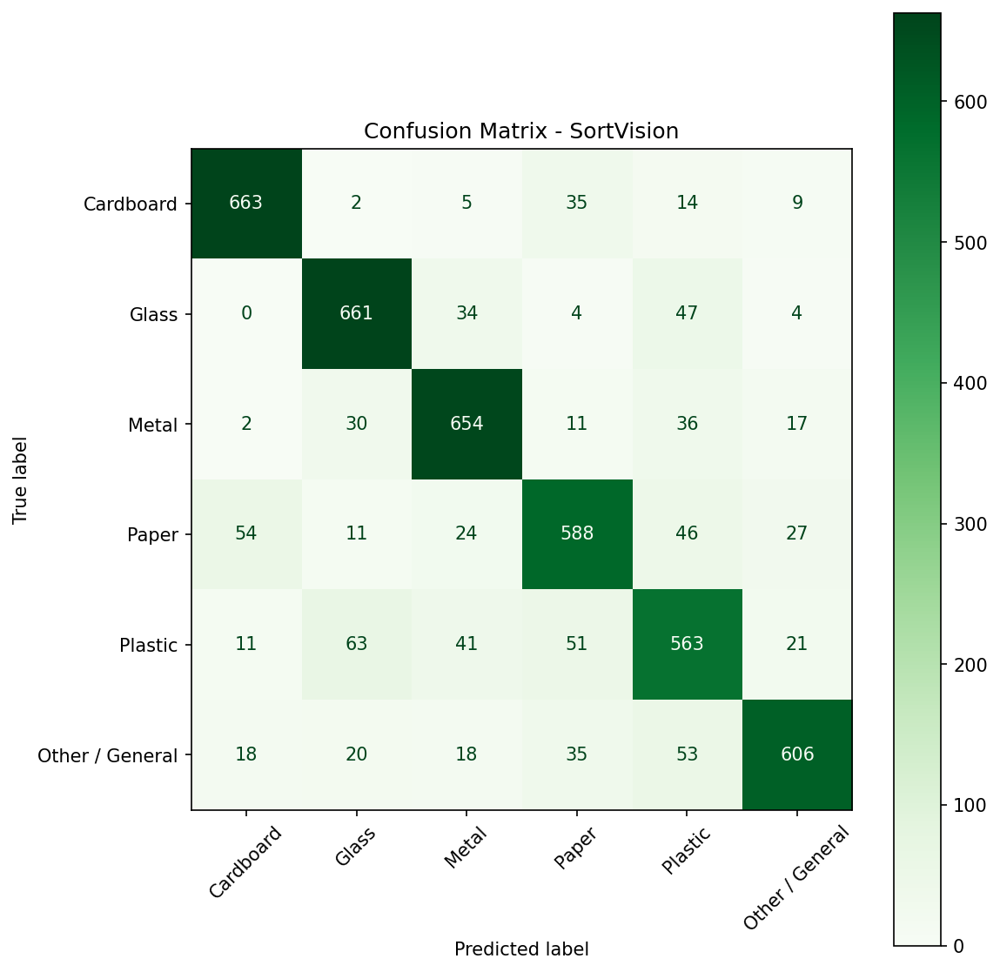
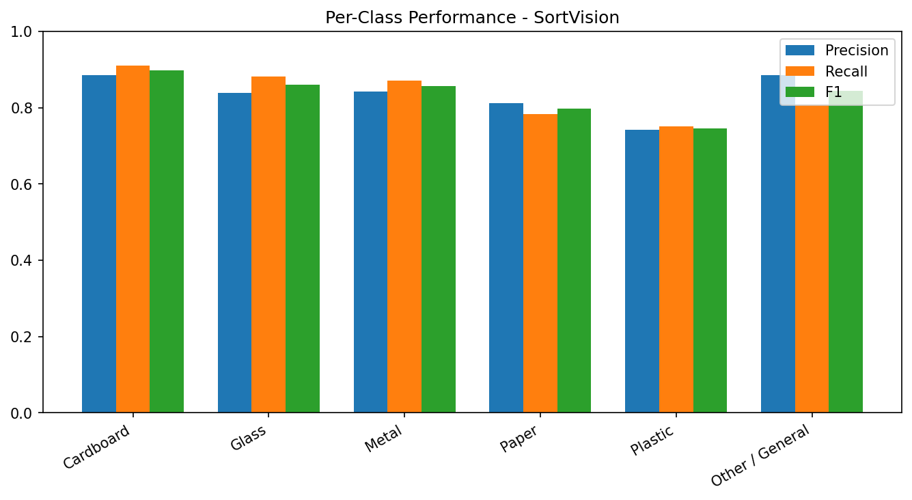
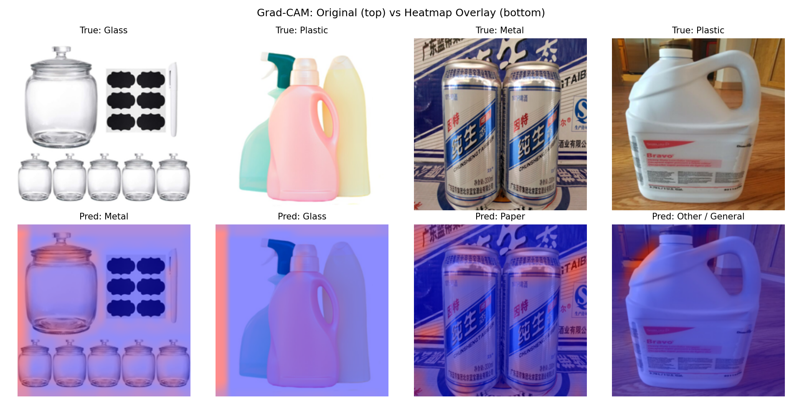
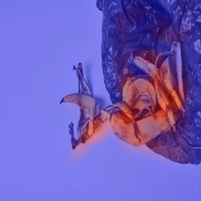

# SortVision

A computer vision project for classifying waste photos into six categories,
built toward circular economy applications such as automated sorting and
improved recycling.

The project compares a from scratch CNN against transfer learning with
MobileNetV2, EfficientNetB0, and ResNet50, adds Grad-CAM explainability, and
includes a web app that supports both image upload and live webcam capture.

## Quick Start

There are two ways to use this project, and they need different things.

To try the trained model, run the web app. This needs the trained model file
but does not need the dataset, so there is nothing to download:

```
git clone <your repository url>
cd sortvision
python -m venv venv
venv\Scripts\activate
pip install -r requirements.txt
uvicorn app:app --reload
```

Then open http://127.0.0.1:8000. On macOS or Linux, activate the environment
with `source venv/bin/activate` instead. The app serves the best model,
EfficientNetB0, from `models/sortvision_cnn_efficientnet_b0.keras`. If that
file is missing, train it first using the steps below. Running the app takes
roughly 1 GB of RAM, see the Deployment section.

To train or evaluate the models yourself, the dataset is needed. It downloads
automatically on the first run, with no manual download, unzip, or folder
setup:

```
python -m src.data_loader
python -m src.train --model_type transfer --backbone efficientnet_b0 --max_train_samples 5000 --max_val_samples 1000
python -m src.evaluate --model_path models/sortvision_cnn_efficientnet_b0.keras
```

## Results

Four models were trained on the same 5,000 image training subsample and the
same 1,000 image validation subsample, to keep CPU training practical. All
four were evaluated on the complete, untouched test split of 4,478 images.
The test set was never subsampled.

| Model            | Test accuracy | Macro F1 | Epochs run          | Training time, approx. |
| ---------------- | ------------- | -------- | ------------------- | ---------------------- |
| From scratch CNN | 0.6498        | 0.6465   | 30                  | 2.8 hours              |
| MobileNetV2      | 0.8095        | 0.8087   | 30                  | 63 minutes             |
| EfficientNetB0   | **0.8524**    | **0.8520** | 30                | 86 minutes             |
| ResNet50         | 0.8341        | 0.8341   | 11, early stopping  | 51 minutes             |

Training times are rough figures from a Windows laptop CPU with no GPU.

EfficientNetB0 scored highest and is the model the web app serves. In the
three transfer models the pretrained backbone is frozen and only the final
classification layer is trained, 7,686 trainable parameters for MobileNetV2
and EfficientNetB0 and 12,294 for ResNet50. In every run the saved model holds
the weights from the epoch with the best validation accuracy, because early
stopping is set to restore the best weights.

ResNet50 stopped at epoch 11. Its validation accuracy peaked at 0.834 in
epoch 6 and did not improve for the next five epochs, which triggered early
stopping. The other two transfer models kept improving slowly and ran all 30
epochs.

### How much to trust the ranking

The gap between the from scratch CNN and any pretrained backbone is large and
is not in doubt. The gaps among the pretrained models are smaller. With 4,478
test images, sampling noise alone is about plus or minus 1 point of accuracy at
these scores, and each model is a single training run with no fixed random
seed. EfficientNetB0 leads ResNet50 by 1.8 points and MobileNetV2 by 4.3
points. The lead over MobileNetV2 is comfortably outside that noise. The lead
over ResNet50 is likely real but should not be treated as certain without
repeated runs.

A separate run of the from scratch configuration in the notebook scored 0.4875
test accuracy, against 0.6498 for the script run reported above, so run to run
variation at this training size is large.

### F1 score by class

| Class           | From scratch | MobileNetV2 | EfficientNetB0 | ResNet50 |
| --------------- | ------------ | ----------- | -------------- | -------- |
| Cardboard       | 0.76         | 0.87        | 0.90           | 0.90     |
| Glass           | 0.73         | 0.85        | 0.88           | 0.86     |
| Metal           | 0.65         | 0.84        | 0.88           | 0.86     |
| Paper           | 0.53         | 0.76        | 0.81           | 0.80     |
| Plastic         | 0.54         | 0.72        | 0.78           | 0.75     |
| Other / General | 0.66         | 0.82        | 0.86           | 0.85     |

Cardboard is the easiest class for every model. Plastic is the hardest class
for all three pretrained models, and the second hardest for the from scratch
CNN, where paper is slightly lower.

### EfficientNetB0 in detail

| Metric             | Value  |
| ------------------ | ------ |
| Test accuracy      | 0.8524 |
| Macro precision    | 0.8518 |
| Macro recall       | 0.8527 |
| Macro F1           | 0.8520 |
| Weighted precision | 0.8517 |
| Weighted recall    | 0.8524 |
| Weighted F1        | 0.8518 |

| Class           | Precision | Recall | F1 Score | Support |
| --------------- | --------- | ------ | -------- | ------- |
| Cardboard       | 0.88      | 0.92   | 0.90     | 728     |
| Glass           | 0.87      | 0.88   | 0.88     | 750     |
| Metal           | 0.86      | 0.90   | 0.88     | 750     |
| Paper           | 0.81      | 0.80   | 0.81     | 750     |
| Plastic         | 0.81      | 0.76   | 0.78     | 750     |
| Other / General | 0.88      | 0.85   | 0.86     | 750     |

Most confused class pairs for EfficientNetB0:

| True class | Predicted as | Images |
| ---------- | ------------ | ------ |
| Paper      | Cardboard    | 59     |
| Plastic    | Glass        | 54     |
| Plastic    | Paper        | 50     |
| Paper      | Plastic      | 41     |
| Glass      | Metal        | 37     |

Paper and cardboard are separate classes in this dataset and look alike. Plastic
covers very different objects, such as clear bottles, bags, and film, so it
overlaps with glass and paper. The same pairs dominate the confusions of the
other models.

### Limitations

The training images are mostly single, isolated items photographed on plain
backgrounds. Real world scenes are different. A photo of several overflowing
garbage bags, mostly plastic cups, plates, and bags on a street, was
classified as Paper with 40.6 percent confidence by the from scratch model and
as Plastic with 91.2 percent confidence by MobileNetV2. One photo is an
anecdote, not an evaluation, and a cluttered scene is still outside what the
training data looks like.

There is no Organic class. A photo of banana peels in a bin was classified as
Other / General by the from scratch model, which matches how this dataset
labels food waste.

The model always picks one of the six classes, it cannot say "this is not waste
at all". Low confidence is therefore worth treating as a warning sign. The web
app shows a caution banner for images with very little visual detail, but that
is a simple heuristic, not a learned out of distribution detector.

## Output Files

Running the notebook and the scripts produces these files in `outputs/`.

### Class distribution

Training images per class, from the notebook.



### Sample images

Example images from each class, from the notebook.



### Training curves

Accuracy, loss, and AUC for train versus validation, from the notebook run of
the from scratch CNN.



### Confusion matrix

Test set confusion matrix written by `src/evaluate.py`. The copy in this
repository is EfficientNetB0's.



### Per class performance

Precision, recall, and F1 per class written by `src/evaluate.py`. The copy in
this repository is EfficientNetB0's.



### Grad-CAM examples

Original test images next to their Grad-CAM heatmap overlays, from the
notebook run of the from scratch CNN.



### Grad-CAM on a single image

Heatmap overlay for one image, written by `src/explain.py`.



## Dataset

This project uses TrashBusters/combined on Hugging Face, a harmonized merge of
four public waste image datasets (TrashNet, Household Garbage, Garbage
Classification V2, TriCascade).

https://huggingface.co/datasets/TrashBusters/combined

29,849 images across six classes: cardboard, glass, metal, paper, plastic,
trash. The dataset ships with its own split of 20,894 training, 4,477
validation, and 4,478 test images.

| Class     | Training images | Share  |
| --------- | --------------- | ------ |
| Cardboard | 3,394           | 16.2%  |
| Glass     | 3,500           | 16.8%  |
| Metal     | 3,500           | 16.8%  |
| Paper     | 3,500           | 16.8%  |
| Plastic   | 3,500           | 16.8%  |
| Trash     | 3,500           | 16.8%  |

The classes are close to balanced. The trash class is shown in the app as
Other / General, since it is the dataset's catch all bucket.

Two honest gaps against a broader waste taxonomy are worth noting. Paper and
cardboard are kept as separate classes rather than merged into one
Paper/Cardboard category. There is no dedicated Organic class, food and
biological waste falls under trash instead. Both are a deliberate starting
point and can be addressed in a second pass by merging in a dataset that
covers organic waste.

### Where the data lives

The images are not stored in this repository, and the `data/` folder in the
project is not used. Do not copy images into it.

The dataset downloads automatically through the Hugging Face datasets library
the first time any script loads it. It is about 2 GB, stored in the Hugging
Face cache on your machine, usually at `~/.cache/huggingface` (on Windows,
`C:\Users\<you>\.cache\huggingface`). It is public and needs no account or
login. Later runs load from that cache instantly, and once it is downloaded
the project works without an internet connection.

To store the cache somewhere else, for example on a drive with more free
space, set the `HF_HOME` environment variable to that folder before running
any script.

The `data/` folder is kept as an empty placeholder, reserved for a planned
second pass that merges in a separate Organic waste dataset.

### What needs the dataset

| Task                                   | Needs the dataset | Needs a trained model |
| -------------------------------------- | ----------------- | --------------------- |
| Web app (`app.py`)                     | No                | Yes                   |
| Single image prediction (`predict.py`) | No                | Yes                   |
| Grad-CAM on an image (`explain.py`)    | No                | Yes                   |
| Training (`train.py`)                  | Yes               | No                    |
| Evaluation (`evaluate.py`)             | Yes               | Yes                   |
| Notebook                               | Yes               | No, it trains its own |

So anyone who only wants to try the model never has to download the dataset.

## Model

The from scratch CNN uses four convolutional blocks, one more than a project
working with small cropped patches would use, since photos at 224 by 224
pixels carry more spatial detail to learn from.

```
Input 224x224x3
Rescaling
Conv2D plus BatchNorm, then MaxPooling
Conv2D plus BatchNorm, then MaxPooling
Conv2D plus BatchNorm, then MaxPooling
Conv2D plus BatchNorm, then MaxPooling
GlobalAveragePooling2D
Dropout 0.5
Dense 256
Dropout 0.3
Softmax Output, 6 classes
```

The transfer models share one head on top of a frozen pretrained backbone:

```
Input 224x224x3
Backbone preprocessing
Pretrained backbone, frozen
GlobalAveragePooling2D
Dropout 0.3
Softmax Output, 6 classes
```

All models use categorical cross entropy loss, the Adam optimizer at a
learning rate of 0.001, batch size 32, up to 30 epochs, class balanced
weighting, early stopping on validation accuracy with a patience of 5, and
learning rate reduction on plateau.

Training augmentation includes horizontal flips, vertical flips, brightness
jitter, and contrast jitter, applied only to the training split.

## Installation

```
python -m venv venv
```

On Windows:

```
venv\Scripts\activate
```

On macOS or Linux:

```
source venv/bin/activate
```

Then install dependencies:

```
pip install -r requirements.txt
```

Check that the dataset loads and that its class order matches `config.py`:

```
python -m src.data_loader
```

The first run downloads the dataset. It prints the splits, the class names,
and the class distribution. If it prints a class order warning, update
`CLASS_NAMES` in `config.py` before training.

### Troubleshooting

If loading fails with a message that a Hugging Face access token has expired,
an old login is cached on the machine. The dataset is public and needs no
login, so delete the cached token file at `~/.cache/huggingface/token` (on
Windows, `C:\Users\<you>\.cache\huggingface\token`) and run the script again.

A warning about symlinks on Windows is harmless. It only means the cache uses
a bit more disk space.

## Training

From scratch CNN on a subsample, for a fast CPU run:

```
python -m src.train --model_type scratch --max_train_samples 5000 --max_val_samples 1000
```

Full dataset, best done on a GPU, for example on Colab:

```
python -m src.train --model_type scratch
```

The from scratch model is saved to `models/sortvision_cnn.keras`.

## Transfer Learning

Each transfer model saves to its own file, so it never overwrites another
model.

```
python -m src.train --model_type transfer --backbone mobilenet_v2 --max_train_samples 5000 --max_val_samples 1000
python -m src.train --model_type transfer --backbone efficientnet_b0 --max_train_samples 5000 --max_val_samples 1000
python -m src.train --model_type transfer --backbone resnet50 --max_train_samples 5000 --max_val_samples 1000
```

| Model file                                   | Size, approx. |
| -------------------------------------------- | ------------- |
| `models/sortvision_cnn.keras`                | 2 to 5 MB     |
| `models/sortvision_cnn_mobilenet_v2.keras`   | 9 MB          |
| `models/sortvision_cnn_efficientnet_b0.keras`| 16 MB         |
| `models/sortvision_cnn_resnet50.keras`       | 91 MB         |

The ResNet50 file is far larger than the rest and sits near Git hosting size
limits, so it is excluded from the repository through `.gitignore`. Use the
same subsample size for every model so the comparison stays fair.

## Evaluation

The default model path is the from scratch model, so pass the model you want
to evaluate:

```
python -m src.evaluate --model_path models/sortvision_cnn_efficientnet_b0.keras
```

Prints accuracy, macro and weighted precision, recall, and F1, a full per
class report, and the most commonly confused class pairs. Saves the confusion
matrix and per class performance charts to `outputs/`.

Both the notebook and this script write `confusion_matrix.png` and
`per_class_performance.png`, and every evaluation run overwrites them. Run the
evaluation for the model you want to show last, so the images match the
numbers.

## Explainability

Grad-CAM highlights which part of an image most influenced a prediction.

```
python -m src.explain --image_path path/to/image.jpg --model_path models/sortvision_cnn_efficientnet_b0.keras
```

Saves a heatmap overlay to `outputs/gradcam_overlay.png`. It works for the
from scratch CNN and for all three transfer models. For transfer models the
target is the backbone's final feature map. The same explanation is available
in the web app through the "Show what the model saw" button after a
prediction.

## Single Image Prediction

```
python -m src.predict --image_path path/to/image.jpg --model_path models/sortvision_cnn_efficientnet_b0.keras
```

Prints the probability for every class and the top prediction.

## Web Interface

A web app is included, supporting both file upload and live webcam capture.

```
uvicorn app:app --reload
```

Then open http://127.0.0.1:8000. Upload a photo, or switch to the Camera tab
to capture one live. The result shows the predicted category, the confidence,
a breakdown across all six classes, and an optional Grad-CAM explanation.

The model the app serves is set by `APP_MODEL_PATH` in `config.py`. To serve a
different model, change that setting. Do not change `CNN_MODEL_PATH` for this
purpose. The training script builds its save paths from `CNN_MODEL_PATH`, so
pointing it at a transfer model would make a later from scratch training run
overwrite that model.

## Project Structure

```
sortvision/
  data/
    README.md
  models/
    sortvision_cnn.keras
    sortvision_cnn_efficientnet_b0.keras
    sortvision_cnn_mobilenet_v2.keras
  notebooks/
    SortVision_Waste_Classification.ipynb
  outputs/
    class_distribution.png
    confusion_matrix.png
    gradcam_examples.png
    gradcam_overlay.png
    per_class_performance.png
    sample_images.png
    training_curves.png
  src/
    __init__.py
    data_loader.py
    dataset.py
    evaluate.py
    explain.py
    gradcam.py
    model.py
    predict.py
    preprocessing.py
    train.py
  static/
    script.js
    style.css
  templates/
    index.html
  .dockerignore
  .gitignore
  app.py
  config.py
  docker-compose.yml
  Dockerfile
  LICENSE
  README.md
  render.yaml
  requirements.txt
```

The `data/` folder holds only a README, the dataset itself lives in the
Hugging Face cache, see the Dataset section. The ResNet50 model file is
excluded from the repository. The virtual environment folder `venv/` is local
only and is not committed.

## Docker

The Dockerfile serves the web app by default and respects the `PORT`
environment variable that hosting platforms set.

```
docker build -t sortvision .
docker run -p 8000:8000 sortvision
```

Then open http://127.0.0.1:8000. The trained models in `models/` are copied
into the image at build time, so train the served model before building. The
container needs roughly 1 GB of memory, see the Deployment section.

`docker-compose.yml` is set up for training, with `models` and `outputs`
mounted as volumes so results persist on the host:

```
docker compose run sortvision python -m src.train --model_type scratch --max_train_samples 5000 --max_val_samples 1000
```

The dataset is downloaded again inside a fresh container, so Docker training
is slower to start than running locally.

## Deployment

### Memory needed

The app was measured by running `app.py` and sending one prediction and one
Grad-CAM request, on a Linux machine with tensorflow-cpu 2.21. The models used
randomly initialised weights of the same architecture, since memory depends on
the architecture and not on the learned values.

| Model served   | After imports | After loading the model and one prediction | Peak after Grad-CAM |
| -------------- | ------------- | ------------------------------------------ | ------------------- |
| EfficientNetB0 | 648 MB        | 774 MB                                     | 934 MB              |
| MobileNetV2    | 650 MB        | 740 MB                                     | 854 MB              |

Importing TensorFlow alone takes about 650 MB. So a host with 512 MB of RAM
cannot run this app whichever model is chosen, and switching to
tensorflow-cpu does not help, since the measurement already used it. Treat
these figures as the right order of magnitude, not exact numbers. A different
machine or the Docker image can differ by some tens of megabytes, so check
memory use on the real host.

### Render

From Render's pricing page, web service plans are Free at 512 MB RAM and 0.1
CPU, Starter at 7 dollars per month with 512 MB RAM and 0.5 CPU, and Standard
at 25 dollars per month with 2 GB RAM and 1 CPU. Starter has the same memory as
Free, it only adds CPU. Standard is the smallest plan that fits this app.
Free web services also spin down after 15 minutes without traffic.

`render.yaml` is therefore set to the Standard plan. Creating the service from
it starts a paid plan, so confirm the cost before deploying.

### Hugging Face Spaces

CPU Basic hardware on Spaces has 2 vCPU and 16 GB of RAM, which is plenty. The
current Hugging Face documentation says that creating a Docker or Gradio Space
that runs on compute requires a paid plan, and that Spaces on free hardware go
to sleep when unused. The documentation was not consistent across versions, so
check the current terms before relying on it.

### A lighter option

Serving a TensorFlow Lite or ONNX export instead of the full Keras model would
remove most of the TensorFlow memory cost and would fit small hosts. Grad-CAM
needs gradients, so it would not work from such an export. This is not
implemented here.

### Other notes

The trained model that the app serves is committed to the repository, since
the build needs it. At about 16 MB it is well within normal Git limits.

If the frontend is hosted separately, for example on Vercel, change the CORS
setting in `app.py` from allowing every origin to allowing only that
frontend's domain.

## Next Steps

Fine tune the best backbone by unfreezing its top layers, which may lift
accuracy beyond the frozen backbone results. Train on the full 20,894 image
training split with GPU acceleration. Repeat each model with several random
seeds so the ranking among the close models is firmer. Merge in a dedicated
Organic waste dataset as a second pass. Look at a TensorFlow Lite export for
lighter hosting.

## Disclaimer

This project is intended for learning and research purposes only. It is not a
guarantee of correct waste sorting, and predictions should not be relied upon
for safety critical or regulatory waste handling decisions.

## License

MIT License